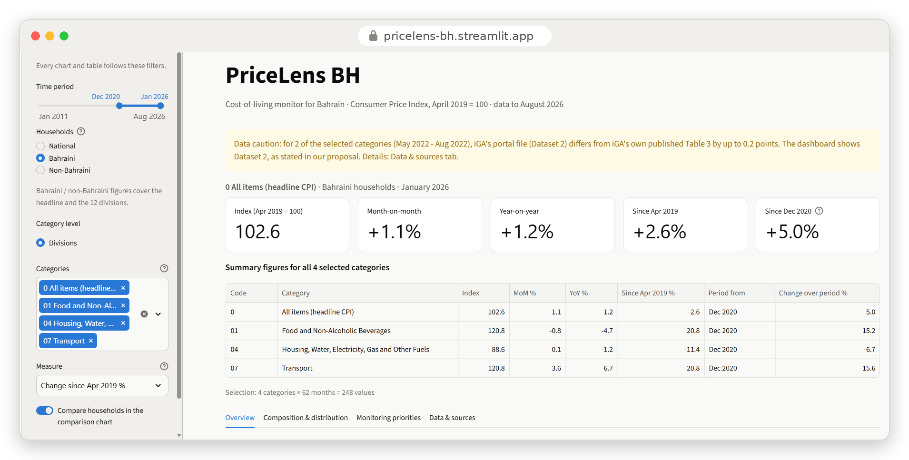
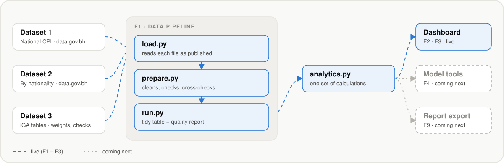

<div align="center">

<a href="https://pricelens-bh.streamlit.app">
  <picture>
    <source media="(prefers-color-scheme: dark)" srcset="docs/images/banner-dark.svg">
    
  </picture>
</a>

<br><br>

[](https://pricelens-bh.streamlit.app)

[](https://www.python.org/downloads/)
[](https://streamlit.io)
[](tests/test_pipeline.py)
[](scripts/check_dev_answers.py)
[](https://www.data.gov.bh)

**IT8413 Generative AI for Data Insights · Group G2 · Bahrain Polytechnic** 🇧🇭

[**Live app**](https://pricelens-bh.streamlit.app) ·
[**Status**](#-project-status) ·
[**Quick start**](#-quick-start) ·
[**How it works**](#-how-it-works) ·
[**Data**](#-data) ·
[**Team**](#-team)

</div>

<br>

<picture>
  <source media="(prefers-color-scheme: dark)" srcset="docs/images/stats-dark.svg">
  
</picture>

<br><br>

<div align="center">
  <a href="https://pricelens-bh.streamlit.app">
    
  </a>
  <br>
  <sub>The live dashboard on Streamlit Community Cloud. Click the picture to open it.</sub>
</div>

<br>

## ✨ What it does

PriceLens BH turns Bahrain's official consumer price index into answers analysts can quote with confidence.
The data pipeline and analytics dashboard (F1 – F3) are complete and live. Questions over the data and the documents (F4 – F8) are answered by Gemini, with every number computed by the app and every document statement cited to its article or page.

<table>
  <tr>
    <td width="33%" valign="top">
      <h3>🔎 Filters in 4 steps</h3>
      Quick periods or any range (Jan 2010 – Aug 2026), households, categories by hand or automatically (fastest
      rising, fastest falling, largest share of spending) and the measure.
    </td>
    <td width="33%" valign="top">
      <h3>📈 Five analytical views</h3>
      Change over time, comparison between categories, the spending basket with what drove prices, a month-by-month
      heat map, and annual averages year by year.
    </td>
    <td width="33%" valign="top">
      <h3>🧮 Numbers in plain words</h3>
      Every key number has a one-line explanation and a small trend chart; an "In plain words" summary is generated
      from the data.
    </td>
  </tr>
  <tr>
    <td width="33%" valign="top">
      <h3>🎯 Monitoring priorities</h3>
      Every division scored against the four criteria in our proposal: rising fastest, furthest from base, large share of spending, different by nationality.
    </td>
    <td width="33%" valign="top">
      <h3>🛡️ Data you can trust</h3>
      Every figure traces back to the dataset it came from. Known problems in the source are flagged on screen,
      empty views say why, and a "Before you quote a figure" box sets out the limits of use.
    </td>
    <td width="33%" valign="top">
      <h3>🏛️ Official look, runs anywhere</h3>
      A calm design with readable contrast, where colour is never the only signal. Open it online, or start it
      locally with one double-click on Windows or one command on macOS and Linux.
    </td>
  </tr>
</table>

## 🧩 Project status

| Part | Features | Status |
|---|---|---|
| Data pipeline and analytics dashboard | F1 · F2 · F3 | ✅ Done |
| Question answering over data, combined questions and follow-ups | F4 · F6 · F8 | ✅ Done ([`src/qa/`](src/qa/)) |
| Document retrieval, citations and refusal | F5 · F7 | ✅ Done ([`src/documents/`](src/documents/)) |
| Query log, configuration display and report export | F9 · F10 | ⏳ Coming next |
| Evaluation runs (control, baseline, v1, v2) | – | ✅ Done ([evaluation plan and results](docs/evaluation_plan.md)) |
| Vendor benchmark and enhancements | – | ⏳ Coming next |

## ✅ Verified against the source

| Check | Result |
|---|---|
| Development questions that use the data | **31 / 31** checks pass (12 questions; for 3 of them the checks confirm the data cannot answer, so the tool must decline) |
| Dataset 1 vs iGA's own Table 2.01 | **5,574 / 5,574** values match |
| Our month-on-month and year-on-year % vs iGA's published % | **4,744 / 4,746** and **4,777 / 4,779** (the exceptions are typos in iGA's tables) |
| Dataset 2 vs iGA's Table 3 | **179** inconsistent values found in 2022, kept as published and flagged in the dashboard |
| 2010 headline, derived from iGA's 12-month changes | December 2010 computed two ways agrees to **0.000** points |
| Dataset 3 version | SHA-256 fingerprint matches the group's copy on every build |
| Automated tests | **221** (all pass; 8 of them need the prepared documents and are skipped without them) |

The 15 held-out test questions were run once, in the final evaluation, after v2 was frozen.

## 🚀 Quick start

> [!TIP]
> **Online:** just open the [live app](https://pricelens-bh.streamlit.app). The steps below are for running it on your own computer.

**You need:** Python 3.12 ([python.org](https://www.python.org/downloads/); on Windows tick **"Add python.exe to PATH"**).
Python 3.12 is what the document search and the evaluation script were run with.

#### 1 · Add Dataset 3 (from the Moodle submission)

iGA's Terms of Use don't allow this file to be republished, so it is **not in the repository**. Save it as:

```
data/raw/CPI-Tables-_Jan2020-Oct_2023.xlsx
```

Or run `python -m scripts.download_sources` to fetch it from iGA's website (its fingerprint is checked).

#### 1b · Add the documents (from the Moodle submission)

The seven documents (Docs 4 – 10) may not be republished either. Put the PDFs in `data/documents/raw/` and
Abrar's hand transcriptions (Docs 5, 7, 8) in `data/documents/transcribed/`, with the file names listed in
[`docs/document_preparation.md`](docs/document_preparation.md). Then build the text and the search passages once:

```bash
python -m src.documents.prepare      # checks each file's fingerprint and extracts the text
python -m src.documents.passages     # splits it into passages and builds the search index
```

The `data/documents/` folder is git-ignored, so none of this is ever committed.

#### 2 · Add the Gemini API key

Needed by the question-answering features (F4 – F8); the dashboard runs without it.
Create `.streamlit/secrets.toml` (git-ignored, never committed):

```toml
GEMINI_API_KEY = "your-key-here"
```

Get a free key at [Google AI Studio](https://aistudio.google.com/apikey). On Streamlit Community Cloud, paste the
same line under **App settings → Secrets**.

#### 3 · Run

| Windows | macOS / Linux |
|---|---|
| Double-click **`run_app.bat`** | `bash run_app.sh` |

The first start takes 2-3 minutes (it creates the environment and installs the pinned packages); later starts take seconds.
The app opens at http://localhost:8501.

<details>
<summary><b>Manual setup</b></summary>

```bash
python -m venv .venv
.venv\Scripts\activate            # macOS / Linux: source .venv/bin/activate
pip install -r requirements.txt
python -m src.pipeline.run        # prepares the data and the quality report
streamlit run src/dashboard/page.py
```
</details>

## 🧭 How it works

<picture>
  <source media="(prefers-color-scheme: dark)" srcset="docs/images/pipeline-dark.svg">
  
</picture>

One set of calculations feeds the dashboard, the model's tools and the report, so a figure is always computed
the same way. The model calls them through [`src/pipeline/tools.py`](src/pipeline/tools.py), which accepts what
users type ("transport", "Aug 2026") and tells apart "not in the sources" (decline) from "unclear request" (ask
again). When the sources don't hold a value, the tool declines instead of guessing.
Full details: [`docs/data_pipeline.md`](docs/data_pipeline.md).

## 💬 Question answering

Open the **Ask a question** tab and ask in plain English, for example *"How did transport prices change year on
year in July 2026?"*.

| | |
|---|---|
| **Model** | Gemini 3.5 Flash-Lite (`gemini-3.5-flash-lite`) through the Gemini API, free tier; temperature 0. Shown in the app. |
| **Numbers** | The model never sees the data. It calls the tools in [`src/pipeline/tools.py`](src/pipeline/tools.py), which compute every figure from the stored values, plus a `calculate` tool for gaps between figures. |
| **Checked** | Every number in an answer is matched against the tool results. A number that no tool returned is shown with a warning. |
| **Traceable** | Under each answer, *How this answer was worked out* lists every tool call, its arguments and the figures it returned. |
| **Declines** | When the data does not hold the answer (forecasts, causes, shop prices, governorates, before 2010) it says *"This is not available in the sources."* |
| **Recorded** | Each answer keeps its tool calls, tokens, response time and settings (`Answer.to_record()`), ready for the query log (F10). |

Design decisions and the settings that v2 may change: [`docs/question_answering.md`](docs/question_answering.md).
Questions over the documents (F5, F7) and combined questions (F6) use the document search tool: see
[`docs/document_retrieval.md`](docs/document_retrieval.md).

## 📏 Evaluation and benchmark

31 test questions (16 development, 15 held-out), four configurations, the same model (Gemini 3.5 Flash-Lite,
temperature 0). Held-out questions were run once, after v2 was frozen. Full plan, metrics and failure analysis:
[`docs/evaluation_plan.md`](docs/evaluation_plan.md). Every answer and score:
[results workbook](results/IT8413%20-%20Group%20Project%20Test%20Set%20and%20Results%20%28G2%29.xlsx).

**Held-out questions (15)**

| Run | What the model gets | Accuracy | Refusal behaviour | Cost per 1,000 questions | Mean latency |
|---|---|---|---|---|---|
| Control | the question only | 20% | 53% | $0.68 | 3.5 s |
| Baseline | all sources pasted into the prompt | 80% | 80% | $71.28 | 43.7 s |
| v1 | the app: data tools + document search | 80% | 100% | $4.55 | 5.6 s |
| **v2** | v1 + search with the user's own question too | **87%** | **100%** | **$4.33** | **4.8 s** |

Cost uses Gemini 3.5 Flash-Lite paid-tier prices ($0.30 input / $2.50 output per 1M tokens, checked 28 Nov 2026).
The vendor benchmark and the two enhancements will be added here.

<details>
<summary><b>Running the evaluation yourself</b></summary>

You need the Gemini key (step 2), Dataset 3 (step 1) and the documents (step 1b). Then:

```bash
python -m scripts.run_evaluation control     # or baseline, v1, v2
python -m scripts.run_evaluation all         # the four, one after the other
python -m scripts.run_evaluation v2 --only 3,13   # re-run some questions (e.g. after a rate-limit error)
```

The questions are read from `results/test_set.csv`. Each run writes:

| File | Holds | In git? |
|---|---|---|
| `results/final/<run>.csv` | one row per question, in the column order of the workbook's *Results* sheet | no |
| `results/final/<run>.jsonl` | the full record: tool calls, retrieved passages, tokens, settings | no (quotes document text) |
| `results/<run>.jsonl`, `results/<run>_scores.csv` | the same answers in the format of `scripts.failure_analysis` | no |

Copy the CSV rows into the workbook's *Results* sheet and score them there. After scoring,
`python -m scripts.failure_analysis v1 --testset results/test_set.csv` runs the failure analysis on all questions.
The held-out questions are part of every run, so use this script only for a final evaluation.
</details>

## 📚 Data

| # | Source (publisher: iGA) | Used for | Terms |
|---|---|---|---|
| 1 | [CPI - Division and Group - Index Number](https://www.data.gov.bh/explore/dataset/01-consumer-price-index-division-and-group-index-number/) | National index: overall + 68 categories | Bahrain Open Government Data License v1.0 |
| 2 | [CPI, Division - Index Numbers by Nationality](https://www.data.gov.bh/explore/dataset/02-cpi-division-index-number-by-nationality/) | Bahraini vs non-Bahraini index | Bahrain Open Government Data License v1.0 |
| 3 | [CPI Tables, Jan 2020 – Oct 2023](https://www.iga.gov.bh/en/Media/Others/Statistical%20Publications/Economic%20Statistics/CPI/CPI-Tables-%20Jan2020-Oct%202023.xlsx) (XLSX download) | Expenditure weights, headline 2011 – 2016 (2010 derived), cross-checks | iGA website Terms of Use (not redistributed) |

Datasets 1 – 2 cover **January 2017 – August 2026** (nationality figures from May 2019), as in the approved
proposal; Dataset 3 takes the overall index back to January 2011, and 2010 is derived from its 12-month changes.
Which values the pipeline changes, and why, is listed in [`docs/data_pipeline.md`](docs/data_pipeline.md); every
check is in [`docs/quality_report.md`](docs/quality_report.md); download dates, versions and terms of every
dataset **and of the seven documents** used for questions over documents are in [`docs/sources.md`](docs/sources.md).

> [!NOTE]
> Contains data from the Information & eGovernment Authority (iGA), Kingdom of Bahrain, via www.data.gov.bh,
> governed by the Bahrain Open Government Data License v1.0 (20 May 2025), available at
> https://www.nea.gov.bh/Documents/OpenDataLicense.pdf. Data extracted on 13/10/2026 (Datasets 1-2).
> Provided "as is" without warranty; to the fullest
> extent permitted by law, the Government of Bahrain is not liable for any loss caused by the use of the data
> or of analyses derived from it. Percentage changes, averages, rankings and contributions are computed by
> Group G2 from the published index numbers; they are not official iGA figures.

<details>
<summary><b>🧪 Checking the results</b></summary>

```bash
python -m scripts.check_dev_answers   # development questions that use the data (31 checks)
python -m scripts.run_evaluation all  # final evaluation, all 31 test questions (see Evaluation)
python -m scripts.check_against_iga   # our % changes vs iGA's own published % changes
python -m pytest -q                   # automated tests
```
</details>

<details>
<summary><b>📁 Project structure</b></summary>

```
data/raw/          source files (Dataset 3 added locally)
data/documents/    the seven documents and their prepared text (added locally, git-ignored)
src/pipeline/      data loading, preparation, calculations and the model's tools
src/dashboard/     Streamlit dashboard: filters, charts and the "Ask a question" tab
src/qa/            questions over the data: Gemini, prompt, settings and the number check
src/documents/     document preparation, passages, search and citations
src/evaluation/    test set reader and failure analysis
scripts/           result checks, evaluation runs, Dataset 3 download, sources record
results/           test set, results workbook, development-run scores
tests/             automated tests
docs/              data preparation, quality report, sources, images
run_app.bat/.sh    one-click start
```

</details>

## 👥 Team

| Member | Leads |
|---|---|
| **Eman Khamdan** | Question answering over data (F4, F6, F8) · test set and evaluation runs · repository and credentials |
| **Fatema Alashiri** | Data pipeline and dashboard (F1 – F3) · query log and report export (F9, F10) · vendor benchmark · enhancements · presentation |
| **Abrar Alawadhi** | Document retrieval, citations and refusal (F5, F7) · sources file · failure analysis · responsible AI · project report |

<br>

<div align="center">
<sub>Built for IT8413 Generative AI for Data Insights · Bahrain Polytechnic · 2026</sub>
</div>
