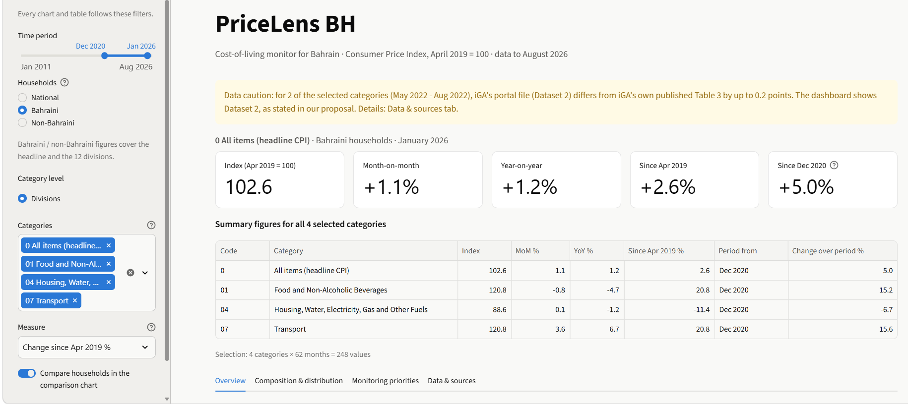
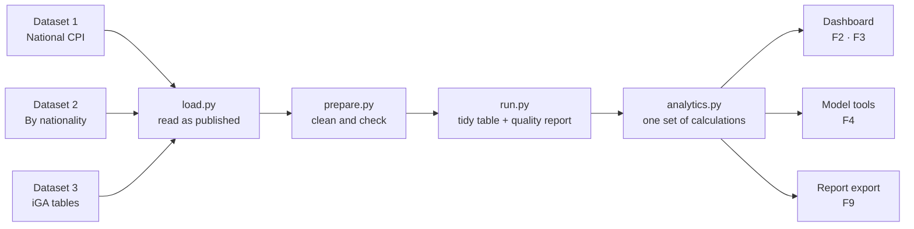

<div align="center">

# 📊 PriceLens BH

**Cost-of-living answers for Bahrain, grounded in official iGA consumer price data**

IT8413 Generative AI for Data Insights · Group G2 · Bahrain Polytechnic

[](https://YOUR-APP.streamlit.app)


[**Live app**](https://YOUR-APP.streamlit.app) · [**Status**](#%EF%B8%8F-project-status) · [**Quick start**](#-quick-start) · [**How it works**](#-how-it-works) · [**Data**](#%EF%B8%8F-data) · [**Team**](#-team)



</div>

---

## ✨ What it does

PriceLens BH turns Bahrain's official consumer price index into answers analysts can quote with confidence.
The data pipeline and analytics dashboard (F1 - F3) are complete and live.

| | Feature | What you get |
|---|---|---|
| 🔎 | **Explore 15 years of prices** | Filter by period (2011 - Aug 2026), household (national, Bahraini, non-Bahraini), category and measure |
| 📈 | **Four analytical views** | Change over time, comparison between categories, basket composition with contributions, and a heatmap |
| 🧮 | **Summary figures** | Index level, month-on-month, year-on-year and change since April 2019 for every selected category |
| 🎯 | **Monitoring priorities** | Every division scored against the four criteria in our proposal: rising fastest, furthest from base, large share of spending, different by nationality |
| ⚠️ | **Data you can trust** | Every figure traces back to the stored values and the dataset it came from; known problems in the source are flagged on screen |

## 🗺️ Project status

| Part | Features | Status |
|---|---|---|
| Data pipeline and analytics dashboard | F1 · F2 · F3 | ✅ Done |
| Question answering over data | F4 · F6 · F8 | ⏳ Coming next |
| Document retrieval, citations and refusal | F5 · F7 | ⏳ Coming next |
| Query log, configuration display and report export | F9 · F10 | ⏳ Coming next |
| Evaluation runs, vendor benchmark and enhancements | - | ⏳ Coming next |

## ✅ Verified against the source

| Check | Result |
|---|---|
| Development questions that use the data | **31 / 31** checks pass (12 questions, including 3 the tool must decline) |
| Dataset 1 vs iGA's own Table 2.01 | **5,574 / 5,574** values match |
| Our month-on-month and year-on-year % vs iGA's published % | **4,744 / 4,746** and **4,777 / 4,779** (the exceptions are typos in iGA's tables) |
| Dataset 2 vs iGA's Table 3 | **179** inconsistent values found in 2022, kept as published and flagged in the dashboard |
| Automated tests | **54** passing |

The held-out test questions are never run before the final evaluation.

## 🚀 Quick start

> **Online:** just open the [live app](https://YOUR-APP.streamlit.app). The steps below are for running it on your own computer.

**You need:** Python 3.10 or newer ([python.org](https://www.python.org/downloads/); on Windows tick **"Add python.exe to PATH"**).

### 1 · Add Dataset 3 (from the Moodle submission)

iGA's Terms of Use don't allow this file to be republished, so it is **not in the repository**. Save it as:

```
data/raw/CPI-Tables-_Jan2020-Oct_2023.xlsx
```

Or run `python -m scripts.download_sources` to fetch it from iGA's website (its fingerprint is checked).

### 2 · Add the Gemini API key

Needed by the question-answering features (F4 - F8); the dashboard runs without it.
Create `.streamlit/secrets.toml` (git-ignored, never committed):

```toml
GEMINI_API_KEY = "your-key-here"
```

<!-- Eman: confirm the key name matches the one the question-answering code reads. -->

### 3 · Run

| Windows | macOS / Linux |
|---|---|
| Double-click **`run_app.bat`** | `bash run_app.sh` |

The first start takes 2-3 minutes (it creates the environment and installs the pinned packages); later starts take seconds.
The app opens at http://localhost:8501.

<details>
<summary><b>Manual setup</b></summary>

```bash
python -m venv .venv
.venv\Scripts\activate            # macOS / Linux: source .venv/bin/activate
pip install -r requirements.txt
python -m src.pipeline.run        # prepares the data and the quality report
streamlit run src/dashboard/page.py
```
</details>

## 🧭 How it works



One set of calculations feeds the dashboard, the model's tools and the report, so a figure is always computed
the same way. When the sources don't hold a value, the functions say so and the tool declines instead of guessing.
Full details: [`docs/data_pipeline.md`](docs/data_pipeline.md).

## 💬 Question answering

> 🚧 *This section will be completed by the question-answering team: how to ask questions over the data and the
> documents (F4 - F8), the model used, and example questions and answers.*

<!-- Eman / Abrar: add the question-answering description, the model and provider, and screenshots here. -->

## 📏 Evaluation and benchmark

> 🚧 *Results of the control, baseline, v1 and v2 runs, the vendor benchmark and the two enhancements will be added
> after the evaluation.*

<!-- Add the results table and the link to the results spreadsheet here. -->

## 🗂️ Data

| # | Source (publisher: iGA) | Used for | Terms |
|---|---|---|---|
| 1 | [CPI - Division and Group - Index Number](https://www.data.gov.bh/explore/dataset/01-consumer-price-index-division-and-group-index-number/) | National index, 69 categories | Bahrain Open Government Data License v1.0 |
| 2 | [CPI, Division - Index Numbers by Nationality](https://www.data.gov.bh/explore/dataset/02-cpi-division-index-number-by-nationality/) | Bahraini vs non-Bahraini index | Bahrain Open Government Data License v1.0 |
| 3 | [CPI Tables, Jan 2020 - Oct 2023](https://www.iga.gov.bh/en/category/statistical-publications) (XLSX) | Expenditure weights, headline from 2011, cross-checks | iGA website Terms of Use (not redistributed) |

The working copy covers **January 2017 - August 2026**, as in the approved proposal. Which values the pipeline
changes, and why, is listed in [`docs/data_pipeline.md`](docs/data_pipeline.md); every check is in
[`docs/quality_report.md`](docs/quality_report.md).

> Contains data from the Information & eGovernment Authority (iGA), Kingdom of Bahrain, used under the Bahrain
> Open Government Data License v1.0. Provided "as is" without warranty; the Government of Bahrain accepts no
> liability for its use. Percentage changes, averages, rankings and contributions are computed by Group G2 and
> are not official iGA figures.

## 🧪 Checking the results

```bash
python -m scripts.check_dev_answers   # development questions that use the data (31 checks)
python -m scripts.check_against_iga   # our % changes vs iGA's own published % changes
python -m pytest -q                   # automated tests
```

## 📁 Project structure

```
data/raw/          source files (Dataset 3 added locally)
src/pipeline/      data loading, preparation and calculations
src/dashboard/     Streamlit dashboard: filters and charts
scripts/           result checks and Dataset 3 download
tests/             automated tests
docs/              data preparation, quality report, images
run_app.bat/.sh    one-click start
```

<!-- Add the folders for the question-answering and document parts here. -->

## 👥 Team

| Member | Leads |
|---|---|
| **Eman Khamdan** | Question answering over data (F4, F6, F8) · test set and evaluation runs · repository and credentials |
| **Fatema Alashiri** | Data pipeline and dashboard (F1 - F3) · query log and report export (F9, F10) · vendor benchmark · enhancements · presentation |
| **Abrar Alawadhi** | Document retrieval, citations and refusal (F5, F7) · sources file · failure analysis · responsible AI · project report |

<div align="center">
<sub>Built for IT8413 Generative AI for Data Insights · Bahrain Polytechnic · 2026</sub>
</div>
